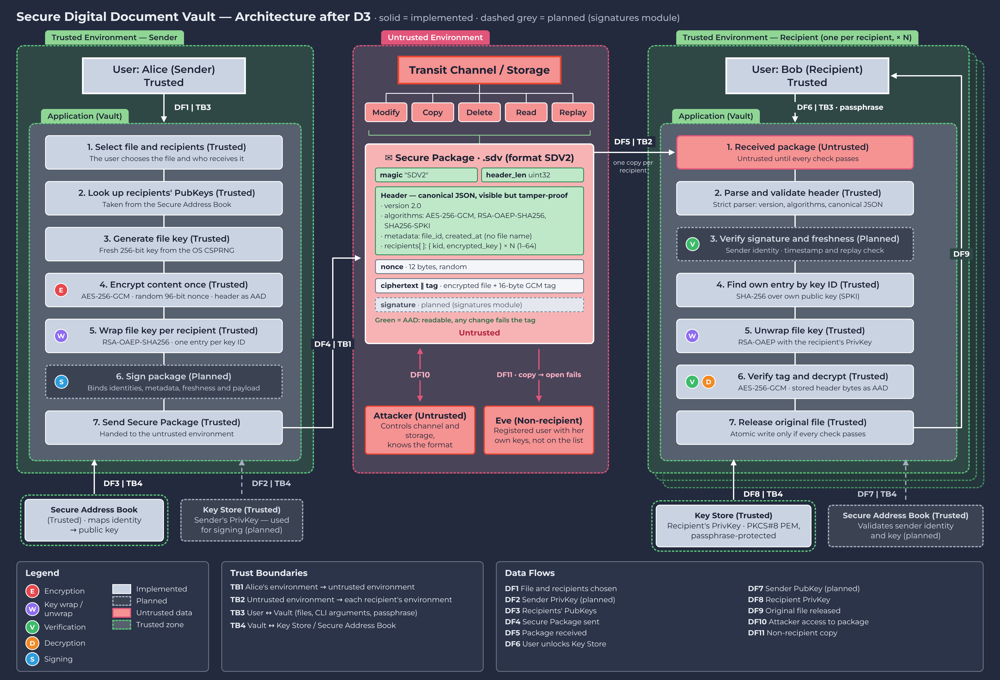

# Secure Digital Document Vault

**Secure File Exchange Platform** · Criptografía, Semester 2027-1, Group 04
Facultad de Ingeniería, Universidad Nacional Autónoma de México
Teacher: Dra. Rocío Alejandra Aldeco Pérez

**Team 05 — CypherPunks:** Arroyo Ramírez Carlos Alberto · Escudero Bohórquez Julio · Martínez Miranda Juan Carlos · Pérez Avin Paola Celina de Jesús · Salgado Miranda Jorge

Two people who do not share a trusted network need to exchange a file that travels through, and may rest in, places neither of them controls. The Vault encrypts the file so that only its intended recipients can read it, detects any change to the content, the metadata or the recipient list, and releases nothing unless every check passes.

| Deliverable | Content | Status |
| --- | --- | --- |
| D1 | Architecture and threat model | [docs/D1-architecture-threat-model.md](docs/D1-architecture-threat-model.md) |
| D2 | Single-owner AEAD encryption (AES-256-GCM, container `SDV1`) | Implemented and tested |
| D3 | Hybrid multi-recipient sharing (RSA-OAEP key wrapping, container `SDV2`) | Implemented and tested |
| D5 | Digital signatures and sender authentication (Ed25519) | Implemented and tested |

## Architecture



The sender's Vault generates a fresh file key, encrypts the file once with AES-256-GCM and wraps that key with RSA-OAEP for every recipient. The Secure Package crosses the untrusted zone, where an attacker can read, copy, modify, replay or delete it. Each recipient's Vault parses the header, finds its own key ID, unwraps the file key with its private key, verifies the tag and only then writes the file. The diagram shows the system at D3: since D5, signing and signature verification (drawn in dashed grey) are implemented. The freshness check is still planned.

The original D1 diagram is kept in [docs/architecture_diagram.png](docs/architecture_diagram.png).

## Repository layout

| Path | Responsibility |
| --- | --- |
| `vault/crypto_core.py` | Key and nonce generation, canonical metadata, AES-256-GCM encrypt / decrypt |
| `vault/container.py` | `SDV1` single-owner container: pack, unpack, structural validation |
| `vault/file_vault.py` | File-level API for D2, atomic writes |
| `vault/keys.py` | RSA-3072 and Ed25519 key pairs, passphrase-protected PEM storage, key IDs |
| `vault/keywrap.py` | Wrap / unwrap the 32-byte file key with RSA-OAEP-SHA256 |
| `vault/container_v2.py` | `SDV2` multi-recipient container, strict header validation, AAD |
| `vault/signatures.py` | Hash, sign and verify with Ed25519 |
| `vault/hybrid.py` | Encrypt once for many recipients and sign, verify and decrypt as one of them |
| `vault/cli.py` | Command-line interface |
| `vault/exceptions.py` | `VaultError`, `IntegrityError`, `ContainerFormatError`, `KeyManagementError` |
| `tests/` | 67 unit tests |
| `docs/` | Design documents and architecture diagrams |

## Requirements

- Python 3.10 or later
- `cryptography` 42 or later, `pytest` 8 or later (see `requirements.txt`)

## Setup

```bash
python -m venv .venv
source .venv/bin/activate        # Windows: .venv\Scripts\activate
pip install -r requirements.txt
```

## D2: Secure Symmetric Encryption Module

The `vault/` package encrypts a file for a single owner with **AES-256-GCM**, a fresh 256-bit key per file and a random 96-bit nonce per encryption. Metadata (algorithm, version, parameters, original name, timestamp) travels in the container header, which is authenticated as AAD. Any change to the ciphertext, nonce, tag or metadata is detected and nothing is written.

Full design and security decisions: [`docs/D2-encryption-design.md`](docs/D2-encryption-design.md)

```bash
python -m vault encrypt contract.pdf                  # -> contract.pdf.sdv + contract.pdf.sdv.key
python -m vault decrypt contract.pdf.sdv -k contract.pdf.sdv.key -o restored.pdf
```

Decryption never overwrites an existing file; add `--force` to allow it.

## D3: Hybrid Encryption (multi-recipient sharing)

A file is encrypted **once** with AES-256-GCM (the D2 core) under a fresh file key, and that key is wrapped with **RSA-OAEP** for each recipient's public key. Only the listed recipients can open the shared `.sdv` (format `SDV2`); the whole recipient list is authenticated as AAD, so adding, removing or swapping recipients is detected.

Full design and security decisions: [`docs/D3-hybrid-design.md`](docs/D3-hybrid-design.md)

## D5: Signatures and authentication

Every shared package is signed with the sender's **Ed25519** key. The signature covers a SHA-256 digest of the complete container, and `open` verifies it before using any secret key.

Full design and security decisions: [`docs/D5-signature-design.md`](docs/D5-signature-design.md)

```bash
python -m vault keygen alice -d keys      # RSA pair + signing pair (alice.sign.key.pem, alice.sign.pub.pem)
python -m vault keygen bob -d keys
python -m vault share report.pdf -r keys/alice.pub.pem -r keys/bob.pub.pem -s keys/alice.sign.key.pem   # -> report.pdf.sdv
python -m vault recipients report.pdf.sdv             # key IDs allowed to open it
python -m vault open report.pdf.sdv -i keys/bob.key.pem --sender keys/alice.sign.pub.pem -o report-bob.pdf
```

Private keys are always stored encrypted with a passphrase. Never commit `*.pem` files.

## D4 demo: required scenarios

The `demo/` folder is ignored by git, so create it locally. Copy any PDF to `demo/reporte.pdf` and generate the three key pairs (each asks for a passphrase twice):

```bash
python -m vault keygen alice -d demo
python -m vault keygen bob -d demo
python -m vault keygen eve -d demo
```

| # | Scenario | Command | Expected result |
| --- | --- | --- | --- |
| 1 | Valid encryption for Alice and Bob | `python -m vault share demo/reporte.pdf -r demo/alice.pub.pem -r demo/bob.pub.pem -s demo/alice.sign.key.pem -o demo/shared.sdv` | Container written; `python -m vault recipients demo/shared.sdv` lists two key IDs |
| 2 | Shared file, recipient decrypts | `python -m vault open demo/shared.sdv -i demo/bob.key.pem --sender demo/alice.sign.pub.pem -o demo/bob-out.pdf` | `bob-out.pdf` identical to the original |
| 3 | Non-recipient cannot decrypt | `python -m vault open demo/shared.sdv -i demo/eve.key.pem --sender demo/alice.sign.pub.pem -o demo/eve-out.pdf` | `ERROR: authentication failed`, no file written |
| 4 | Modified file fails | see below | `ERROR: authentication failed`, no file written |

Scenario 4 flips the last byte of the container and tries to open the copy:

```bash
python -c "d=bytearray(open('demo/shared.sdv','rb').read()); d[-1]^=1; open('demo/tampered.sdv','wb').write(d)"
python -m vault open demo/tampered.sdv -i demo/bob.key.pem --sender demo/alice.sign.pub.pem -o demo/bob-tampered.pdf
```

`open` refuses to overwrite an existing output, so delete old outputs before running the demo again.

## Tests

```bash
The mapping from each D2 and D3 requirement to its tests is in the design documents.

## Known limitations

- **Freshness (SR-05)**: a captured package can be replayed. `created_at` and `file_id` are signed, but nothing tracks them yet.
- **Authentic public keys (SR-10)**: public keys are `.pub.pem` files the users trust; there is no certificate validation yet.
- **`SDV1` file name**: the single-owner format keeps the original file name in the clear (authenticated, but visible). `SDV2` no longer stores it.
```
| `tests/test_metadata.py` | 7 | Required fields, base name only, canonical form, strict parsing |
| `tests/test_randomness.py` | 4 | 256-bit keys, 96-bit nonces, fresh keys, unique nonces |
| `tests/test_cli.py` | 5 | D2 command-line flow, tampered input, key file permissions, no overwrite |
| `tests/test_hybrid.py` | 18 | Two recipients, unauthorized user, tampered / swapped / removed recipients, wrong keys, downgrade, truncation |


| File | Tests | Covers |
| --- | --- | --- |
| `tests/test_aead.py` | 13 | AES-GCM round trip, wrong key, modified ciphertext / tag / nonce / metadata, nonce reuse leak |
| `tests/test_container.py` | 8 | `SDV1` structure and validation |
| `tests/test_file_vault.py` | 12 | File-level encryption, tampering, safe failure, no overwrite |

