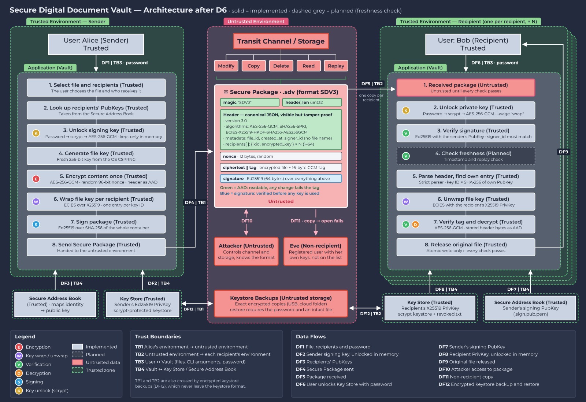

# Secure Digital Document Vault

**Secure File Exchange Platform** · Criptografía, Semester 2027-1, Group 04
Facultad de Ingeniería, Universidad Nacional Autónoma de México
Teacher: Dra. Rocío Alejandra Aldeco Pérez

**Team 05 — CypherPunks:** Arroyo Ramírez Carlos Alberto · Escudero Bohórquez Julio · Martínez Miranda Juan Carlos · Pérez Avin Paola Celina de Jesús · Salgado Miranda Jorge

Two people who do not share a trusted network need to exchange a file that travels through, and may rest in, places neither of them controls. The Vault encrypts the file so that only its intended recipients can read it, detects any change to the content, the metadata or the recipient list, and releases nothing unless every check passes.

| Deliverable | Content | Status |
| --- | --- | --- |
| D1 | Architecture and threat model | [docs/D1-architecture-threat-model.md](docs/D1-architecture-threat-model.md) |
| D2 | Single-owner AEAD encryption (AES-256-GCM, container `SDV1`) | Implemented and tested |
| D3 | Hybrid multi-recipient sharing (ECIES over X25519 key wrapping, container `SDV3`) | Implemented and tested |
| D4 | Midterm system presentation and security review | [docs/D4-midterm-system-presentation-&-security-review.pdf](docs/D4-midterm-system-presentation-%26-security-review.pdf) |
| D5 | Digital signatures and sender authentication (Ed25519) | Implemented and tested |
| D6 | Key management: password-protected keystore (scrypt + AES-256-GCM), backup and restore | Implemented and tested |

## Architecture



The sender unlocks their signing key from a password-protected keystore, generates a fresh file key, encrypts the file once with AES-256-GCM, wraps that key with ECIES over X25519 for every recipient and signs the finished container with Ed25519. The Secure Package crosses the untrusted zone, where an attacker can read, copy, modify, replay or delete it. Each recipient unlocks their own keystore, verifies the signature, finds their key ID in the header, unwraps the file key, verifies the tag and only then writes the file. Keystores can be backed up to untrusted storage because they stay encrypted. Only the freshness check, drawn in dashed grey, is still planned.

Earlier versions are kept in [docs/architecture_diagram.png](docs/architecture_diagram.png) (D1) and [docs/architecture_diagram_d3.png](docs/architecture_diagram_d3.png) (D3).

## Repository layout

| Path | Responsibility |
| --- | --- |
| `vault/crypto_core.py` | Key and nonce generation, canonical metadata, AES-256-GCM encrypt / decrypt |
| `vault/container.py` | `SDV1` single-owner container: pack, unpack, structural validation |
| `vault/file_vault.py` | File-level API for D2, atomic writes |
| `vault/keys.py` | X25519 and Ed25519 key pairs, public PEM files, key IDs |
| `vault/keystore.py` | Password-protected keystore (scrypt + AES-256-GCM), backup and restore |
| `vault/revocation.py` | Local key revocation list checked by `share` and `open` |
| `vault/keywrap.py` | Wrap / unwrap the 32-byte file key with ECIES over X25519 (HKDF-SHA256, AES-256-GCM) |
| `vault/container_v2.py` | `SDV3` multi-recipient container, strict header validation, AAD |
| `vault/signatures.py` | Hash, sign and verify with Ed25519 |
| `vault/hybrid.py` | Encrypt once for many recipients and sign, verify and decrypt as one of them |
| `vault/cli.py` | Command-line interface |
| `vault/exceptions.py` | `VaultError`, `IntegrityError`, `ContainerFormatError`, `KeyManagementError` |
| `tests/` | 117 unit tests |
| `docs/` | Design documents and architecture diagrams |

## Requirements

- Python 3.10 or later
- `cryptography` 42 or later, `pytest` 8 or later (see `requirements.txt`)

## Setup

```bash
python -m venv .venv
source .venv/bin/activate        # Windows: .venv\Scripts\activate
pip install -r requirements.txt
```

## D2: Secure Symmetric Encryption Module

The `vault/` package encrypts a file for a single owner with **AES-256-GCM**, a fresh 256-bit key per file and a random 96-bit nonce per encryption. Metadata (algorithm, version, parameters, original name, timestamp) travels in the container header, which is authenticated as AAD. Any change to the ciphertext, nonce, tag or metadata is detected and nothing is written.

Full design and security decisions: [`docs/D2-encryption-design.md`](docs/D2-encryption-design.md)

```bash
python -m vault encrypt contract.pdf                  # -> contract.pdf.sdv + contract.pdf.sdv.key
python -m vault decrypt contract.pdf.sdv -k contract.pdf.sdv.key -o restored.pdf
```

No command overwrites an existing container, key file, output or keystore; add `--force` to `encrypt`, `decrypt`, `share` or `open` to allow it.

## D3: Hybrid Encryption (multi-recipient sharing)

A file is encrypted **once** with AES-256-GCM (the D2 core) under a fresh file key, and that key is wrapped with **ECIES over X25519** for each recipient's public key. Only the listed recipients can open the shared `.sdv` (format `SDV3`); the whole recipient list is authenticated as AAD, so adding, removing or swapping recipients is detected.

Full design and security decisions: [`docs/D3-hybrid-design.md`](docs/D3-hybrid-design.md)

## D5: Signatures and authentication

Every shared package is signed with the sender's **Ed25519** key. The signature covers a SHA-256 digest of the complete container, and `open` verifies it before using any secret key.

Full design and security decisions: [`docs/D5-signature-design.md`](docs/D5-signature-design.md)

```bash
python -m vault keygen alice            # keystore/: alice.key.json, alice.pub.pem, alice.sign.key.json, alice.sign.pub.pem
python -m vault keygen bob
python -m vault share report.pdf -r keystore/alice.pub.pem -r keystore/bob.pub.pem -s keystore/alice.sign.key.json   # -> report.pdf.sdv
python -m vault recipients report.pdf.sdv             # key IDs allowed to open it
python -m vault open report.pdf.sdv -i keystore/bob.key.json --sender keystore/alice.sign.pub.pem -o report-bob.pdf
```

## D6: Key management

Private keys are never stored in plaintext. Each one lives in its own keystore file, encrypted with AES-256-GCM under a key that **scrypt** derives from the user's password. The password is asked for every time a key is needed and is never stored. Any change to a keystore is detected.

Full design and security discussion: [`docs/D6-key-management.md`](docs/D6-key-management.md)

```bash
python -m vault backup keystore/alice.key.json keystore/alice.sign.key.json   # -> backups/
python -m vault restore backups/alice.key.json                               # asks for the password -> keystore/
python -m vault revoke keystore/bob.pub.pem                                  # adds its key ID to keystore/revoked.txt
```

Never commit `keystore/`, `backups/` or `*.pem` files.

## D4 demo: required scenarios

The `demo/` folder is ignored by git, so create it locally. Copy any PDF to `demo/reporte.pdf` and generate the three key pairs (each asks twice for a password of at least 12 characters):

```bash
python -m vault keygen alice -d demo
python -m vault keygen bob -d demo
python -m vault keygen eve -d demo
```

| # | Scenario | Command | Expected result |
| --- | --- | --- | --- |
| 1 | Valid encryption for Alice and Bob | `python -m vault share demo/reporte.pdf -r demo/alice.pub.pem -r demo/bob.pub.pem -s demo/alice.sign.key.json -o demo/shared.sdv` | Container written; `python -m vault recipients demo/shared.sdv` lists two key IDs |
| 2 | Shared file, recipient decrypts | `python -m vault open demo/shared.sdv -i demo/bob.key.json --sender demo/alice.sign.pub.pem -o demo/bob-out.pdf` | `bob-out.pdf` identical to the original |
| 3 | Non-recipient cannot decrypt | `python -m vault open demo/shared.sdv -i demo/eve.key.json --sender demo/alice.sign.pub.pem -o demo/eve-out.pdf` | `ERROR: authentication failed`, no file written |
| 4 | Modified file fails | see below | `ERROR: authentication failed`, no file written |

Scenario 4 flips the last byte of the container and tries to open the copy:

```bash
python -c "d=bytearray(open('demo/shared.sdv','rb').read()); d[-1]^=1; open('demo/tampered.sdv','wb').write(d)"
python -m vault open demo/tampered.sdv -i demo/bob.key.json --sender demo/alice.sign.pub.pem -o demo/bob-tampered.pdf
```

`open` refuses to overwrite an existing output, so delete old outputs before running the demo again.

## Tests

```bash
python -m pytest -v
```

| File | Tests | Covers |
| --- | --- | --- |
| `tests/test_aead.py` | 16 | AES-GCM round trip, wrong key, modified ciphertext / tag / nonce / metadata, nonce reuse leak |
| `tests/test_container.py` | 8 | `SDV1` structure and validation |
| `tests/test_file_vault.py` | 12 | File-level encryption, tampering, safe failure, no overwrite |
| `tests/test_metadata.py` | 7 | Required fields, base name only, canonical form, strict parsing |
| `tests/test_randomness.py` | 4 | 256-bit keys, 96-bit nonces, fresh keys, unique nonces |
| `tests/test_cli.py` | 11 | D2 command-line flow, tampered input, key file permissions, no overwrite for every command |
| `tests/test_hybrid.py` | 21 | Two recipients, unauthorized user, tampered / swapped / removed recipients, wrong keys, downgrade, truncation, RSA keys rejected, ECIES wrapping |
| `tests/test_signatures.py` | 5 | D5 required tests A to E |
| `tests/test_keystore.py` | 11 | D6 required tests: correct and wrong password, modified keystore (4 fields), backup and restore, stolen keystore; RSA keys rejected, owner-only backups |
| `tests/test_revocation.py` | 11 | Revocation, planned rotation, malformed keystores |
| `tests/test_malformed.py` | 11 | Truncated, empty and corrupted signed packages never reach key recovery |

The mapping from each requirement to its tests is in the design documents.

## Known limitations

- **Freshness (SR-05)**: a captured package can be replayed. `created_at` and `file_id` are signed, but nothing tracks them yet.
- **Authentic public keys (SR-10)**: public keys are `.pub.pem` files the users trust; there is no certificate validation yet.
- **Key lifecycle (D6)**: revocation is local to each user (`revoke` edits their own `revoked.txt`), and a forgotten password cannot be recovered.
- **`SDV1` file name**: the single-owner format keeps the original file name in the clear (authenticated, but visible). `SDV3` does not store it.

## Changes after review (November 2026)

SDV3 replaces the RSA-based SDV2 format: file keys are now wrapped with ECIES over X25519. Added key revocation (`revoke`), a no-overwrite policy (`--force`) and tests for malformed packages. SDV2 files cannot be opened by this version.
